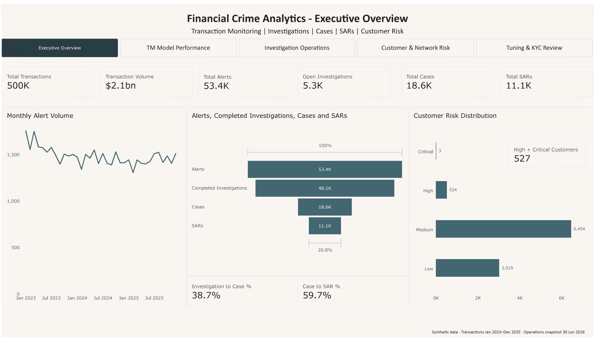
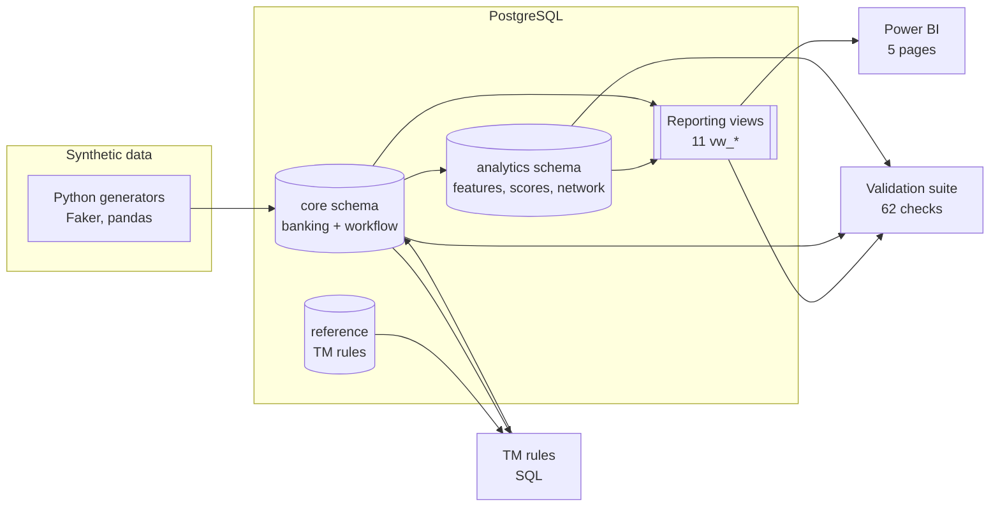
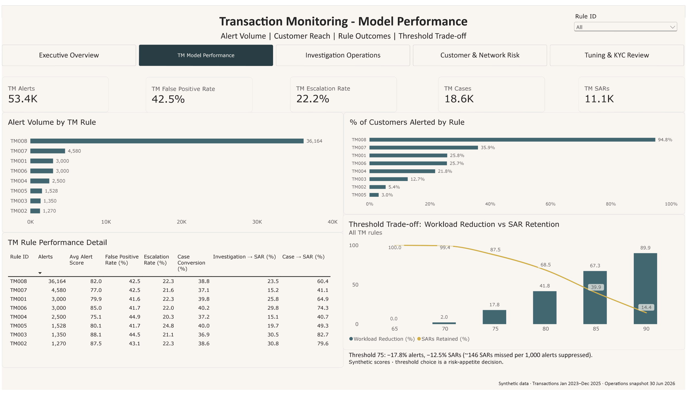
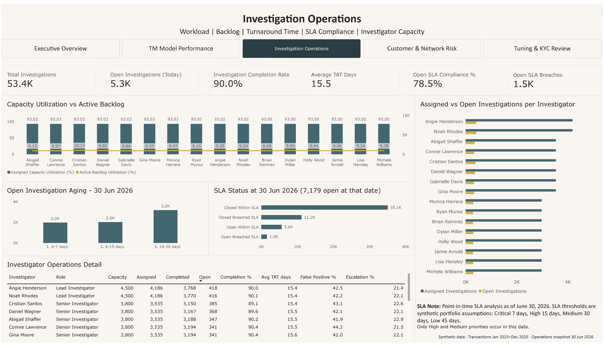
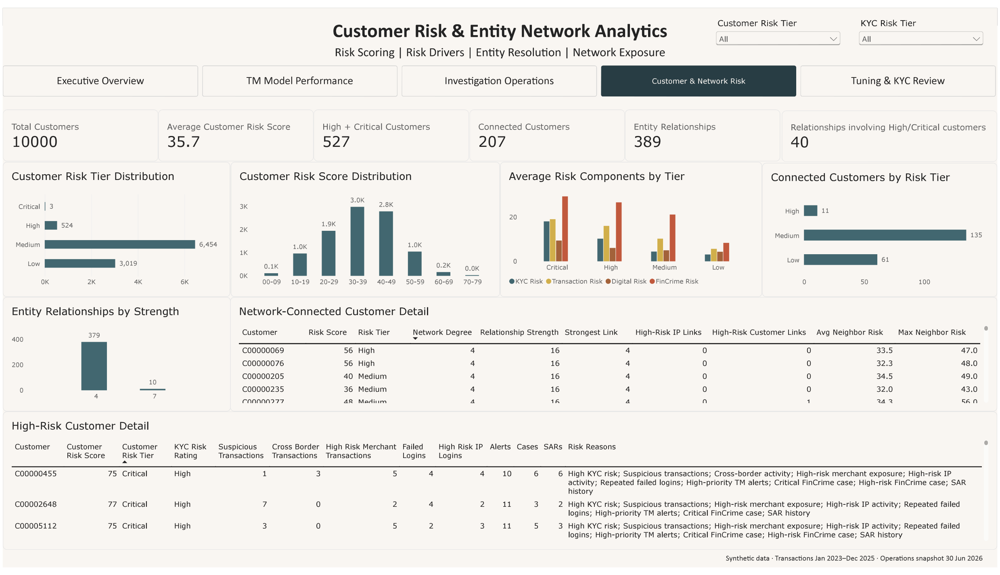
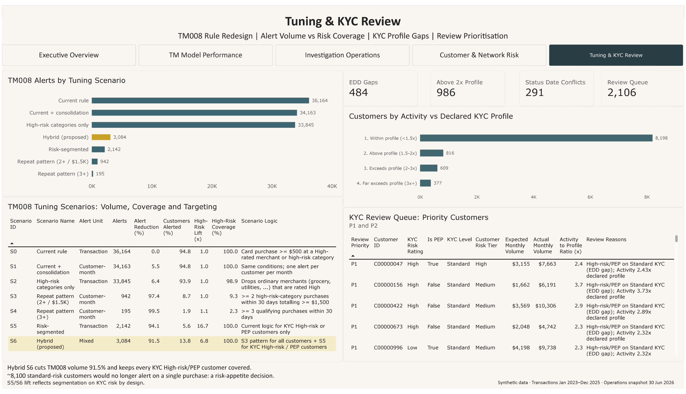

# Financial Crime Analytics Platform

An end-to-end AML / transaction-monitoring analytics platform built on a synthetic bank: PostgreSQL data model,
eight TM rules, a full alert → investigation → case → SAR workflow, rule tuning, customer risk scoring, entity resolution,
KYC review, a 62-check validation suite and a Power BI report.



## Business problem

A bank's financial crime team needs to answer:

- **Transaction monitoring:** Which rules generate the workload, and can they be tuned without missing suspicious activity?
- **Operations:** Is the investigation backlog under control, and where are SLAs breached?
- **Customer risk:** Which customers carry the most risk, and why?
- **Entity resolution:** Which customers are genuinely connected?
- **KYC:** Are customer profiles and due-diligence levels consistent with risk and behaviour?

## Highlights

- **Diagnosed a noisy rule and designed its replacement.** TM008 produces 67.7% of alerts and alerts on 94.8% of customers
  with no risk discrimination (lift 0.99). Replayed seven redesigns; a hybrid repeat-pattern / risk-segmented design cuts
  volume by 91.5% while keeping every high-risk customer covered.
- **Quantified the cost of threshold tuning.** Raising the alert-score threshold to 75 cuts workload 17.8% but misses 1,385
  SARs: about 146 SARs per 1,000 alerts suppressed.
- **Corrected entity over-linking.** Naive shared-IP matching produced 2,240,183 relationships; an IP-prevalence check showed
  that 99.8% of IPs are shared infrastructure. Rare-IP evidence leaves 389 relationships.
- **Found KYC control gaps.** 80% of high-risk customers are on standard rather than enhanced due diligence; declared activity
  profiles have no correlation with behaviour. Built a prioritised review queue of 2,106 customers.
- **Validated everything.** 62 reconciliation, integrity and lifecycle checks found and drove the fix of 99,358 transactions
  dated before account opening. Known limitations are reported as warnings, not hidden.

Details: [key findings](docs/key_findings.md).

## Architecture



Business logic lives in SQL views, so the Power BI report contains no hidden calculations and every number is reconciled.

## Dataset (synthetic)

| Entity | Count | | Entity | Count |
|---|---:|---|---|---:|
| Customers | 10,000 | | Alerts (8 rules) | 53,392 |
| Accounts | 21,501 | | Investigations | 53,392 |
| Transactions (2023-2025) | 500,000 | | Cases | 18,597 |
| Transaction volume | $2.10B | | SARs | 11,103 |
| Login events | 305,734 | | Audit events | 411,231 |

## What's inside

| Capability | Implementation |
|---|---|
| TM rules TM001-TM008 | [`sql/01_alert_generation`](sql/01_alert_generation) |
| Rule performance, threshold simulation, TM008 tuning | [`sql/02_tm_performance`](sql/02_tm_performance), [`76`](sql/06_powerbi_semantic_layer/76_tm_threshold_simulation.sql) |
| Investigator workload, TAT, SLA and aging | [`sql/03_investigation_operations`](sql/03_investigation_operations) |
| Customer risk scoring and KYC profile review | [`sql/04_customer_risk`](sql/04_customer_risk) |
| Entity resolution and network metrics | [`sql/05_entity_network`](sql/05_entity_network) |
| Power BI semantic layer | [`sql/06_powerbi_semantic_layer`](sql/06_powerbi_semantic_layer) |
| Validation suite and runner | [`sql/validation`](sql/validation), [`python/validation`](python/validation) |
| Synthetic data generators | [`python/data_generation`](python/data_generation) |
| Power BI report | [`powerbi`](powerbi) |

## Dashboard

| | |
|---|---|
|  |  |
| TM Model Performance | Investigation Operations |
|  |  |
| Customer & Network Risk | Tuning & KYC Review |

Page descriptions: [powerbi/README.md](powerbi/README.md).

## Data validation

[`validation_suite.sql`](sql/validation/validation_suite.sql) runs 62 checks in one read-only query: data quality, lifecycle
ordering, audit trail, risk-score rules, network reconciliation, and every Power BI view reconciled back to the core tables.

**Current result: 60 PASS, 2 WARN, 0 FAIL** ([full report](docs/validation_results.md)).

## Tech stack

PostgreSQL (CTEs, window functions, views) · SQL · Python (pandas, SQLAlchemy, Faker) · Power BI / DAX · Git

## Run it

```bash
pip install -r requirements.txt
copy .env.example .env
```

Then build the schema, generate data, and run the SQL packs in the order given in the
[runbook](docs/project_runbook.md), and validate with `python python/validation/run_validation_suite.py`.

## Documentation

| Document | Contents |
|---|---|
| [Key findings](docs/key_findings.md) | Nine business findings with evidence and caveats |
| [Methodology](docs/methodology.md) | Rule logic, SLA, tuning, scoring, entity resolution, KYC review, validation design |
| [Data dictionary](docs/data_dictionary.md) | Every table and view: grain, keys, row counts, meaning |
| [Validation results](docs/validation_results.md) | Generated output of the 62-check suite |
| [Limitations](docs/limitations.md) | What the synthetic data can and cannot show; v1.1 plan |
| [Runbook](docs/project_runbook.md) | Rebuild order with checkpoints |

## Limitations

All data is synthetic. Investigation dispositions and alert scores are generated, so outcome rates (false positives, SAR
yield) are generator settings, not findings. The pipeline, analysis methods, validation and reporting are the
demonstration. See [limitations.md](docs/limitations.md) for the full list and the v1.1 plan.
