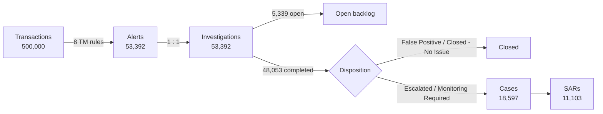

# Methodology

How each analytical component works, which file implements it, and which assumptions it rests on.
All data is synthetic; see [limitations.md](limitations.md) before interpreting any outcome metric.

- [1. Alert lifecycle](#1-alert-lifecycle)
- [2. Transaction monitoring rules](#2-transaction-monitoring-rules)
- [3. Investigation operations and SLA](#3-investigation-operations-and-sla)
- [4. TM rule performance and threshold simulation](#4-tm-rule-performance-and-threshold-simulation)
- [5. TM008 tuning scenarios](#5-tm008-tuning-scenarios)
- [6. Customer risk scoring](#6-customer-risk-scoring)
- [7. Entity resolution and network analytics](#7-entity-resolution-and-network-analytics)
- [8. KYC profile review](#8-kyc-profile-review)
- [9. Validation approach](#9-validation-approach)

---

## 1. Alert lifecycle

| Stage | Table | Rule |
|---|---|---|
| Alert | `core.alerts` | One alert per triggering transaction and rule |
| Investigation | `core.investigations` | Exactly one per alert, assigned to one of 16 investigators |
| Disposition | `core.investigations.disposition` | Set only when the investigation is closed |
| Case | `core.cases` + `core.case_alerts` | Opened from a completed investigation; a case can group several alerts for the customer (54,674 case-alert links) |
| SAR | `core.sar_reports` | At most one per case; `Filed` (10,230) or `Under Review` (873) |
| Audit trail | `core.audit_logs`, `core.investigator_actions`, `core.case_notes` | Every assignment, completion, case and SAR event is logged |

Funnel conversions used on the dashboards:
- **Investigation → case** = cases / completed investigations = 18,597 / 48,053 = **38.70%**
- **Case → SAR** = SARs / cases = 11,103 / 18,597 = **59.70%**

## 2. Transaction monitoring rules

Rule metadata lives in `reference.alert_rules`; alert generation lives in [`sql/01_alert_generation/`](../sql/01_alert_generation).
Every rule is evaluated per transaction. Alert scores are drawn at random inside a rule-specific band (see limitations).

| Rule | Name | Implemented logic | Score band | Priority | Alerts |
|---|---|---|---|---|---:|
| TM001 | Structuring | Cash deposit between $8,500 and $10,000 (capped at 3,000 transactions) | 70-90 | High | 3,000 |
| TM002 | High-Risk Geography | Origin or destination in RU, NG, KY, PA, TR, AE | 80-95 | High | 1,270 |
| TM003 | Dormant Account Activity | Transaction >= $10,000 after >= 180 days of account inactivity | 82-94 | High | 1,350 |
| TM004 | Rapid Movement of Funds | Online transfer >= $10,000 (capped at 2,500 transactions) | 65-85 | Medium | 2,500 |
| TM005 | Shared Device Risk | Transaction on a device used by >= 3 distinct customers | 70-90 | Medium | 1,528 |
| TM006 | Large Wire Transfer | Wire transfer >= $25,000 (capped at 3,000 transactions) | 75-95 | High | 3,000 |
| TM007 | Round Dollar Pattern | Whole-dollar transaction >= $1,000 | 68-86 | Medium | 4,580 |
| TM008 | High-Risk Merchant | Card purchase >= $500 at a merchant rated High, or in Money Services, Crypto Exchange, Gaming, Jewelry, Pawn Shop | 72-92 | High if merchant rated High, else Medium | 36,164 |

TM001, TM004 and TM006 alerts come from labelled scenario transactions (`core.transactions.suspicious_flag`, 8,500 rows) set in
[`01_tm001_tm004_tm006_scenarios.sql`](../sql/01_alert_generation/01_tm001_tm004_tm006_scenarios.sql).

> **Metadata vs implementation.** `reference.alert_rules.threshold_value` does not match the implemented logic for TM003
> ($2,500 recorded vs $10,000 implemented) and TM004 ($5,000 recorded vs $10,000 implemented). The table above documents
> what the SQL actually does. Aligning rule metadata with implementation is listed in [limitations.md](limitations.md).

## 3. Investigation operations and SLA

Files: [`sql/03_investigation_operations/`](../sql/03_investigation_operations), view `analytics.vw_investigation_sla`.

- **Point-in-time snapshot:** 2026-06-30 23:59:59. An investigation is *open at snapshot* if it started on or before the snapshot
  and had not ended by then. This is why 7,179 investigations are open at the snapshot while 5,339 are open today (the
  difference closed after 30 June).
- **Lifecycle days** = (end, or snapshot if still open) − start.
- **SLA thresholds (synthetic portfolio assumptions):**

| Alert priority | SLA (days) | Present in data |
|---|---:|---|
| Critical | 7 | No |
| High | 15 | 26,035 alerts |
| Medium | 30 | 27,357 alerts |
| Low | 45 | No |

- **SLA status:** Closed Within SLA, Closed Breached SLA, Open Within SLA, Open Breached SLA.
- **Aging buckets** for open investigations: 0-7, 8-15, 16-30, 31+ days.
- **Turnaround time (TAT)** = average lifecycle days of closed investigations.
- **Capacity utilisation** = assigned investigations / investigator `workload_capacity`; **active backlog utilisation** uses open investigations.

## 4. TM rule performance and threshold simulation

Files: [`37_46_tm_model_tuning_validation_pack.sql`](../sql/02_tm_performance/37_46_tm_model_tuning_validation_pack.sql),
views `analytics.vw_tm_rule_performance` and `analytics.vw_tm_threshold_simulation`
([`76_tm_threshold_simulation.sql`](../sql/06_powerbi_semantic_layer/76_tm_threshold_simulation.sql)).

Rule metrics: false-positive rate = False Positive dispositions / completed investigations; escalation rate = Escalated /
completed; case conversion = cases / completed; case → SAR = SARs / cases.

**Threshold simulation (retrospective what-if).** For each candidate score threshold from 65 to 90 in steps of 5, alerts scoring
below the threshold are treated as suppressed, and the view reports:

| Metric | Definition |
|---|---|
| `workload_reduction_pct` | Suppressed alerts / all alerts |
| `sars_retained_pct` | SARs whose alert is retained / all SARs |
| `sars_missed_per_1k_suppressed` | SARs lost per 1,000 alerts suppressed: the cost of suppression |
| `retained_alert_to_sar_pct` | SAR yield of the remaining queue |

65 is the baseline (the lowest score in the data). The simulation does not change any rule and does not select a threshold:
the choice is a risk-appetite decision.

## 5. TM008 tuning scenarios

File: [`77_tm008_tuning_scenarios.sql`](../sql/02_tm_performance/77_tm008_tuning_scenarios.sql), view `analytics.vw_tm008_tuning_scenarios`.

Seven versions of TM008 are replayed against the same transactions:

| ID | Scenario | Alert unit |
|---|---|---|
| S0 | Current rule | Transaction |
| S1 | Current rule, one alert per customer per month | Customer-month |
| S2 | High-risk categories only (drops ordinary merchants rated High) | Transaction |
| S3 | >= 2 high-risk-category purchases within 30 days totalling >= $1,500 | Customer-month |
| S4 | >= 3 qualifying purchases within 30 days | Customer-month |
| S5 | Current logic for KYC High-risk or PEP customers only | Transaction |
| S6 | Hybrid: S3 for all customers + S5 for KYC High-risk / PEP customers | Mixed |

Rolling 30-day behaviour uses window functions (`RANGE BETWEEN INTERVAL '30 days' PRECEDING AND CURRENT ROW`).

**How scenarios are compared.** Not on case/SAR outcomes, because synthetic dispositions carry no signal. Instead:
- **Workload:** alerts, reduction vs S0, customers alerted.
- **Targeting:** share of alerted customers who are KYC High-risk or PEP, divided by the population share (**lift**; 1.0 = no
  better than random). KYC rating and PEP status are set at onboarding, independent of alert history.
- **Coverage:** share of the high-risk customers alerted today who remain alerted.

S5 and S6 select on KYC risk by design, so their lift is a design property, not a discovered pattern.

## 6. Customer risk scoring

File: [`47_55_customer_risk_engine.sql`](../sql/04_customer_risk/47_55_customer_risk_engine.sql); tables
`analytics.customer_risk_features` (raw features) and `analytics.customer_risk_score` (scores, tier, reasons).

A transparent 0-100 score: four capped components, each built from banded points.

| Component | Cap | Signals (points) |
|---|---:|---|
| KYC | 25 | KYC rating High 18 / Medium 9 / Low 2; PEP +7 |
| Transaction | 30 | Labelled suspicious transactions (5/9/12), cross-border count (2/4/6), wire volume (1/3/5), high-risk merchant purchases (1/3/4), foreign beneficiary countries (1/3) |
| Digital | 15 | Failed logins (1/2/4), high-risk-IP logins (2/4/6), non-MFA logins (1/2/3), login devices (1/2) |
| FinCrime history | 30 | Alert count (2/4/6), distinct rules (1/2/4), high-priority alerts (2/4), worst case rating (2/4/6), SARs (8/10) |

**Tiers:** Critical >= 75, High >= 55, Medium >= 30, Low < 30. Every customer gets `risk_reasons`, a readable list of
the signals that contributed.

## 7. Entity resolution and network analytics

File: [`56_65_entity_resolution_network_analytics.sql`](../sql/05_entity_network/56_65_entity_resolution_network_analytics.sql).

**The problem.** Linking every pair of customers who logged in from the same IP produced **2,240,183 relationships**. Prevalence
analysis showed why: 19,956 of 20,000 IPs are each used by more than 5 customers (up to 37). A shared IP used by dozens of
unrelated customers (mobile carrier, VPN, public Wi-Fi) is infrastructure, not evidence of a relationship.

**The correction.**
1. Compute each IP's prevalence (distinct customers).
2. Treat an IP as linkage evidence only if 2-5 customers use it (44 IPs qualify). Common IPs stay available as risk signals
   but never create a relationship.
3. Score each pair: 4 points per rare shared IP, +3 if that IP is high-risk. A high-risk IP strengthens a relationship but
   cannot create one.
4. Store pairs canonically (`customer_1 < customer_2`) and compute per-customer degree, strength and neighbour risk.

**Result:** 389 relationships, 207 connected customers (max degree 4); 40 relationships involve a High/Critical-tier customer.

## 8. KYC profile review

File: [`78_kyc_profile_review.sql`](../sql/04_customer_risk/78_kyc_profile_review.sql), view `analytics.vw_kyc_profile_review`.

| Flag | Definition |
|---|---|
| EDD gap | KYC High-risk or PEP customer on Standard (not Enhanced) due diligence |
| Activity exceeds profile | Average monthly activity >= 2x declared `expected_monthly_txn_volume` |
| Status/date conflict | KYC status `Expired` while `next_review_date` is after the 2026-06-30 snapshot |

Average monthly activity = total transaction amount / months from the customer's first transaction month through Dec 2025.

| Priority | Rule |
|---|---|
| P1 | EDD gap and activity >= 2x profile |
| P2 | EDD gap, or activity >= 2x profile for a High/Critical-tier customer |
| P3 | Activity >= 2x profile, status/date conflict, or KYC not Approved |

## 9. Validation approach

File: [`validation_suite.sql`](../sql/validation/validation_suite.sql), runner
[`run_validation_suite.py`](../python/validation/run_validation_suite.py), results [validation_results.md](validation_results.md).

62 checks in seven areas: data quality, lifecycle, audit trail, customer risk, entity network, Power BI layer and the v1.0
baseline. Design choices:
- **Reconciliation over hard-coding:** most checks compare one layer with another (for example, executive view alerts =
  `COUNT(core.alerts)`), so they stay valid after data is regenerated. Only the four baseline checks hold fixed numbers.
- **Severity:** *Error* (FAIL) means data or a reported metric is wrong. *Warning* (WARN) marks a known limitation that
  feeds no reported metric; it is shown, not hidden.
- **Read-only:** the runner executes inside a `READ ONLY` transaction.

Each analysis pack also keeps its own V-checks, run right after the pack builds.
